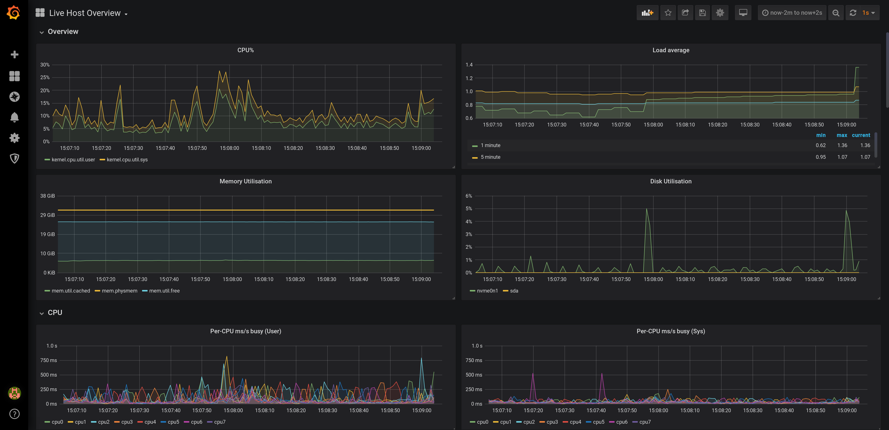
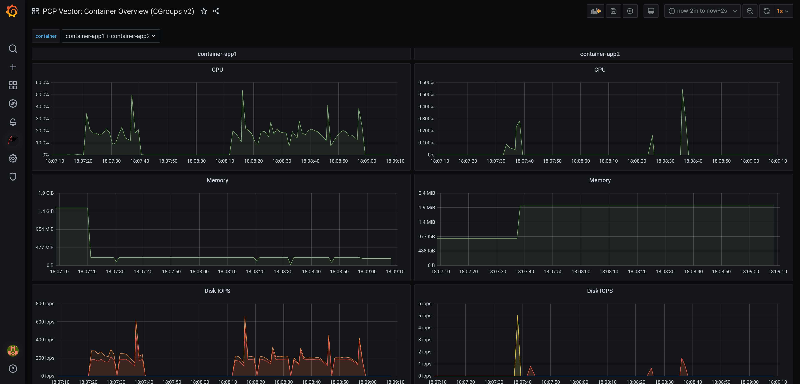
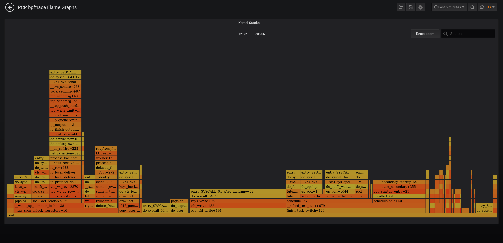
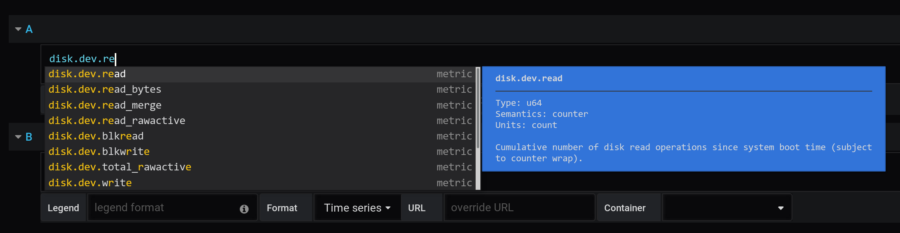

# Performance Co-Pilot Grafana Plugin

[](https://github.com/performancecopilot/grafana-pcp/actions?query=workflow:CI)
[](https://grafana-pcp.readthedocs.io/en/latest/?badge=latest)


## Overview

[Performance Co-Pilot (PCP)](https://pcp.io) provides a framework and services to support system-level performance monitoring and management.
It presents a unifying abstraction for all of the performance data in a system, and many tools for interrogating, retrieving and processing that data.

This Grafana app plugin integrates PCP metrics into Grafana, bundling three datasources and premade dashboards for real-time monitoring, historical analysis, and eBPF tracing.

[](https://raw.githubusercontent.com/performancecopilot/grafana-pcp/main/src/img/screenshots/vector-overview.png)
[](https://raw.githubusercontent.com/performancecopilot/grafana-pcp/main/src/img/screenshots/vector-containers.png)
[](https://raw.githubusercontent.com/performancecopilot/grafana-pcp/main/src/img/screenshots/bpftrace-flame-graph.png)
[](https://raw.githubusercontent.com/performancecopilot/grafana-pcp/main/src/img/screenshots/vector-metric-autocompletion.png)

[More screenshots](https://github.com/performancecopilot/grafana-pcp/tree/main/src/img/screenshots)

## Requirements

- **Grafana** >= 12.4.3
- **Performance Co-Pilot (PCP)** with `pmcd` and `pmproxy` running on the monitored host(s)
  - PCP Vector and PCP bpftrace connect to `pmproxy` for real-time metrics
- **Valkey** (or Redis) with `pmlogger` archiving metrics and `pmproxy` configured to write to the key server for the PCP Valkey datasource
- **bpftrace** installed on the monitored host for the PCP bpftrace datasource
- For **full-text metric search**: `pmproxy` with `[pmsearch] enabled = true` and a search index built by `pmsearch_daily(1)` (SQLite-backed; requires a PCP release that includes the reimplemented search backend)

## Getting Started

1. **Install the plugin** from the [Grafana plugin catalog](https://grafana.com/grafana/plugins/performancecopilot-pcp-app/) or with the Grafana CLI:
   ```bash
   grafana cli plugins install performancecopilot-pcp-app
   ```

2. **Enable the app plugin** in Grafana under **Administration > Plugins > Performance Co-Pilot** and click **Enable**.

3. **Configure a datasource** under **Connections > Data sources > Add data source**:
   - **PCP Vector** — for real-time metrics from a single host. Set the URL to your `pmproxy` instance (default: `http://localhost:44322`).
   - **PCP Valkey** — for historical metrics stored in Valkey/Redis. Set the URL to your `pmproxy` instance.
   - **PCP bpftrace** — for eBPF tracing scripts. Set the URL to your `pmproxy` instance.

4. **Import bundled dashboards** from each datasource's settings page under the **Dashboards** tab. The PCP Vector Checklist dashboards use the [USE method](http://www.brendangregg.com/usemethod.html) to detect potential performance issues.

## Upgrading from PCP Redis to PCP Valkey

PCP Redis was renamed to PCP Valkey in v5.2.0. If you are upgrading from the catalog's v5.0.0 release, or any installation still using PCP Redis, you must migrate existing PCP Redis datasources. The datasource type changed from `performancecopilot-redis-datasource` to `performancecopilot-valkey-datasource`.

Until migrated, these datasources cannot run queries, and alert rules using them fail with `plugin not registered`. Plan the upgrade and migration together to minimize the interruption to dashboards and alerting. PCP Vector and PCP bpftrace datasources do not need this migration.

Update each existing datasource in place, keeping its UID, URL and settings. Do not delete and recreate it: retaining the UID preserves references from dashboards and alert rules. Saved credentials are retained when updating the existing datasource without replacing its secure settings. This plugin migration does not require replacing a Redis server with Valkey.

Dashboard data source variables that filter by `performancecopilot-redis-datasource` no longer list migrated datasources. In each affected dashboard's variable settings, change the datasource type filter to **PCP Valkey** (`performancecopilot-valkey-datasource`).

### Datasources created through Grafana

As an administrator, open **Administration > Plugins > Performance Co-Pilot > Config** and click **Migrate PCP Redis data sources**. The action migrates the PCP Redis datasources returned by Grafana in the current organization and reports the result for each one. For organizations that exceed Grafana's datasource list limit, use the manual procedure below for any remaining datasources. Only read-only provisioned datasources are skipped. Editable provisioned datasources may be migrated by the action, but their YAML must also be updated as described below before restarting Grafana or reloading provisioning, or provisioning may restore the Redis type. After migration, check your dashboards and alert rules.

To migrate manually instead, follow these steps:

Use the [Grafana datasource API](https://grafana.com/docs/grafana/latest/developer-resources/api-reference/http-api/data_source/#update-an-existing-data-source) with credentials that have permission to read and update the datasource.

1. Retrieve the existing datasource configuration with `GET /api/datasources/uid/<uid>`. Its UID is available in the datasource's Grafana settings URL, or by listing datasources with `GET /api/datasources`.
2. In the returned configuration, change `"type": "performancecopilot-redis-datasource"` to `"type": "performancecopilot-valkey-datasource"`. Keep the UID and all other settings unchanged. Do not add or replace `secureJsonData`; Grafana retains the saved credentials.
3. Send the updated configuration as the JSON body of `PUT /api/datasources/uid/<uid>`, using the same UID.

For example, using `curl` and `jq`, set the values below for your Grafana instance and existing PCP Redis datasource, then run:

```bash
GRAFANA_URL='http://localhost:3000'
GRAFANA_TOKEN='<service-account-token>'
DATASOURCE_UID='<existing-pcp-redis-uid>'

curl --fail --silent --show-error \
  -H "Authorization: Bearer $GRAFANA_TOKEN" \
  "$GRAFANA_URL/api/datasources/uid/$DATASOURCE_UID" \
  -o pcp-redis-datasource.json &&
jq '.type = "performancecopilot-valkey-datasource"' \
  pcp-redis-datasource.json > pcp-valkey-datasource.json &&
curl --fail --silent --show-error \
  -X PUT \
  -H "Authorization: Bearer $GRAFANA_TOKEN" \
  -H 'Content-Type: application/json' \
  --data-binary @pcp-valkey-datasource.json \
  "$GRAFANA_URL/api/datasources/uid/$DATASOURCE_UID"
```

Repeat for each PCP Redis datasource, then use **Save & test** in Grafana and check its dashboards and alert rules.

### Provisioned datasources

Read-only provisioned datasources cannot be migrated through the API. For all provisioned datasources, including editable ones already migrated using the action or API, update the provisioning YAML before restarting Grafana or reloading provisioning to prevent the Redis type from being restored.

1. In the datasource's provisioning YAML, change `type: performancecopilot-redis-datasource` to `type: performancecopilot-valkey-datasource`. Keep its UID and other settings unchanged.
2. If the configuration uses a `version` field, increment it, then restart Grafana or reload datasource provisioning.
3. Verify the datasource, dashboards and alert rules.

## Features

* Analysis of historical PCP metrics using [pmseries](https://man7.org/linux/man-pages/man1/pmseries.1.html) query language
* Analysis of real-time PCP metrics using [pmwebapi](https://man7.org/linux/man-pages/man3/pmwebapi.3.html) live services
* Enhanced Berkeley Packet Filter (eBPF) tracing using [bpftrace](https://github.com/iovisor/bpftrace/blob/master/README.md) scripts
* Dashboards for detecting potential performance issues using the Utilization Saturation and Errors (USE) method [2]
* Full-text search in metric names, descriptions, instances [1]
* Support for [Grafana Alerting](https://grafana.com/docs/grafana/latest/alerting/) [1]
* Support for [derived metrics](https://man7.org/linux/man-pages/man3/pmregisterderived.3.html#DESCRIPTION) (arithmetic operators and statistical functions inside a query) [2]
* Automated configuration of metric units [1,2,3]
* Automatic rate and time utilization conversion
* Heatmap, table [2,3] and flame graph [3] support
* Auto completion of metric names [1,2], qualifier keys and values [1], and bpftrace probes, builtin variables and functions [3]
* Display of semantics, units and help texts of metrics [2] and bpftrace builtins [3]
* Legend templating support with `$metric`, `$metric0`, `$instance`, `$some_label`, `$some_dashboard_variable`
* Container support [1,2]
* Support for custom endpoint and hostspec per panel [2,3]
* Support for repeated panels
* Sample dashboards for all datasources

[1] PCP Valkey
[2] PCP Vector
[3] PCP bpftrace

## [Documentation](https://grafana-pcp.readthedocs.io)

## [Contributing](https://github.com/performancecopilot/grafana-pcp/blob/main/CONTRIBUTING.md)
